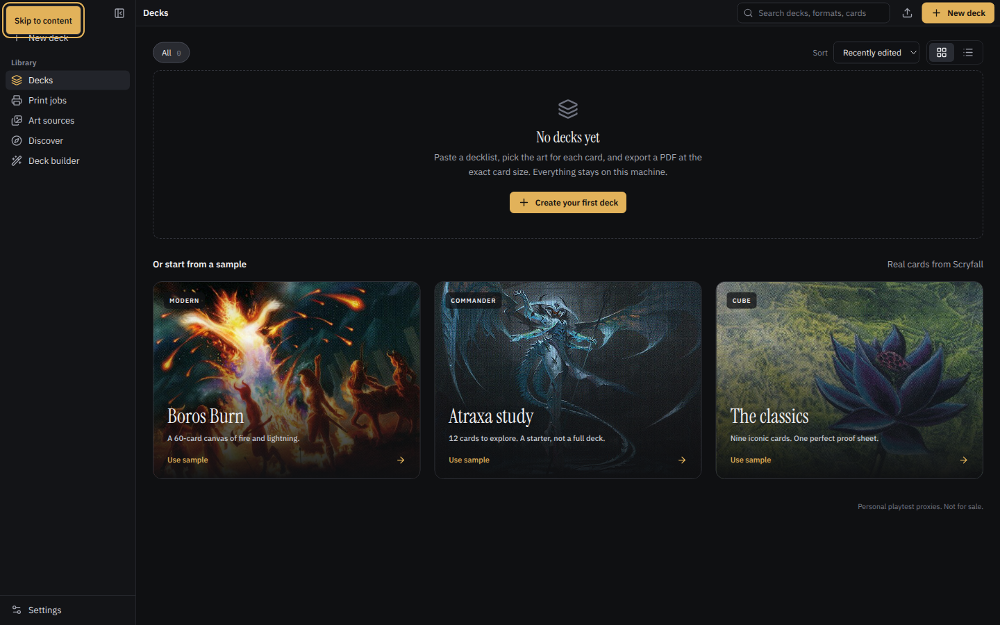
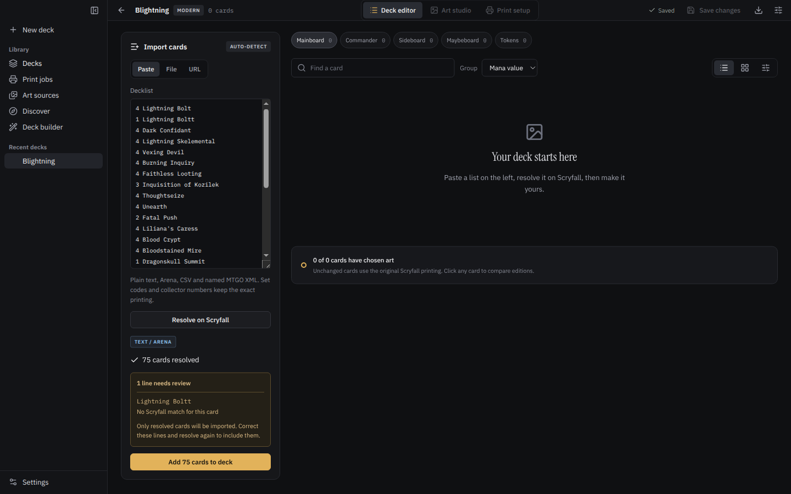
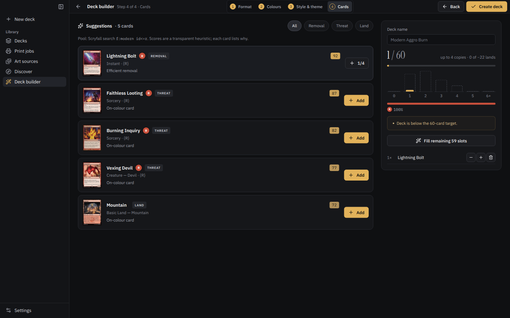
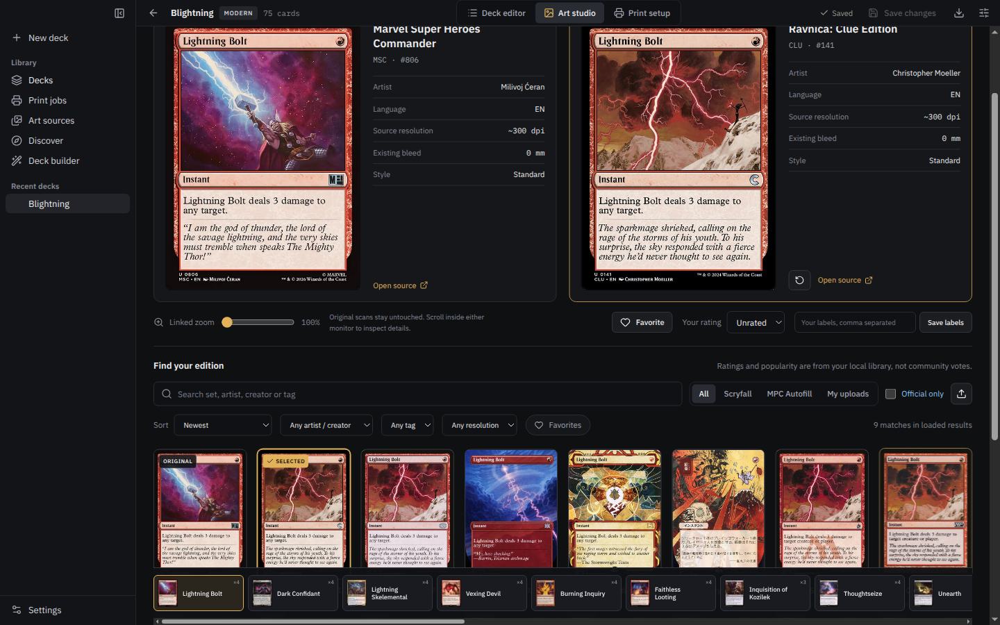
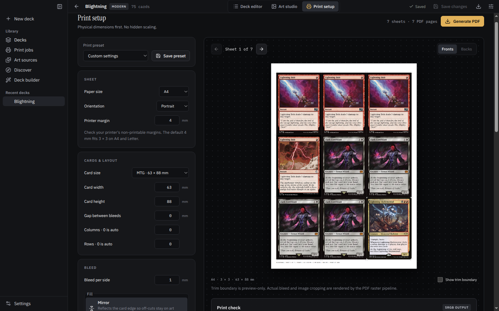
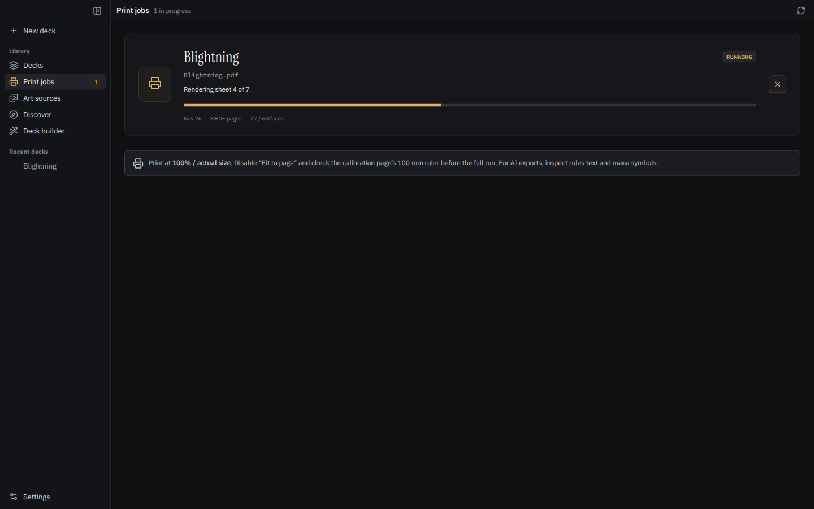
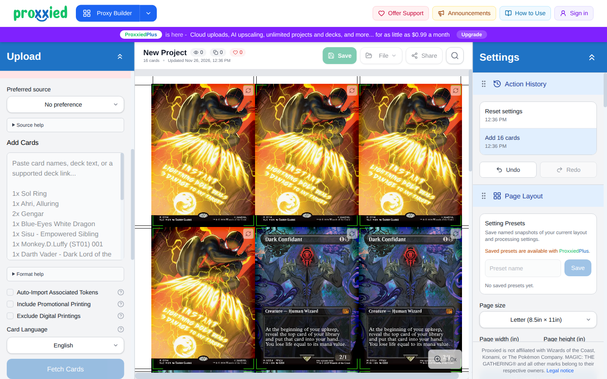
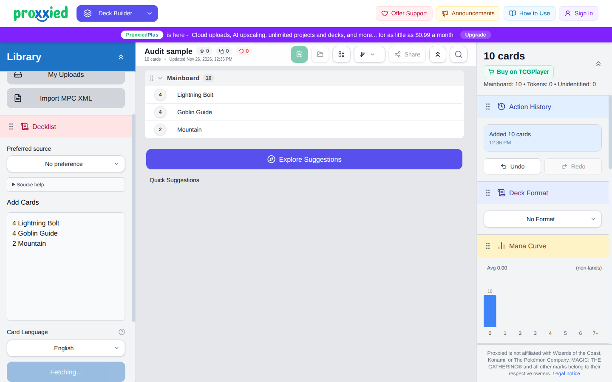
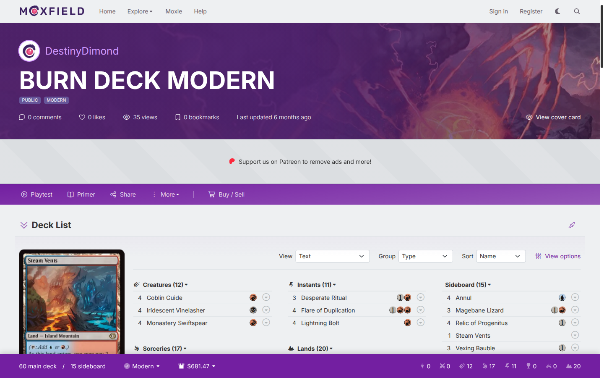

# Deckpress UX and visual style audit

Issue [#22](https://github.com/kerbaras/deckpress/issues/22), for [v0.4.0](https://github.com/kerbaras/deckpress/issues/23). Audited main at `0859698` on 2026-11-26. No application changes.

Fix the print count and the builder's silent removal of picks before changing the look. Keep the sidebar, the print proof and the side-by-side art comparison. The biggest layout improvement is to make each view answer one question at a time: What did I import? What am I about to change? What will come out of the printer?

## Method and limits

- Ran `pnpm --filter @deckpress/web dev` in Linux Chrome at 1440 × 900 CSS pixels. A browser-only mock answered Tauri IPC; React, decklist parsing, UI state, and the TypeScript sheet layout ran as shipped. The 60-card main deck and 15-card sideboard are from [Blightning](https://moxfield.com/decks/9ic6qFnBYk2yYWZRh4Orvg), with public Scryfall scans. A misspelling, refused URL, and export progress were injected. The sheet uses source scans in place of Rust's processed previews.
- Clicked through the five journeys and used real keyboard events for selected navigation checks. Inspected the rendered styles and relevant source. This is a single-reviewer heuristic pass, not user research or a WCAG conformance claim. Native window dragging and caption buttons, real Scryfall resolution through Deckpress, uploads, screen readers, native dialogs, PDF creation and file actions, and physical print/cut were not verified.
- Benchmarked the public web apps in the same browser, signed out. Captions say where a flow was only inspected rather than completed. Code references below point to the audited revision.

## Journeys

### 1. First run and import

The empty library explains the end result, says everything stays on this machine, and offers three sample decks. The main action, **Create your first deck**, opens a name/format dialog. A user with a list has to name an empty project first; the import methods only appear in its editor. **Build with suggestions** is in the dialog and the sidebar. The empty library also shows sort and layout controls before there are decks to sort.

[Library while opening](ux-audit/deckpress-library-loading.png). The spinner and “Opening your library…” distinguish loading from an empty library. The shared loading component has `role="status"` (`apps/web/src/ui.tsx:58–64`; `apps/web/src/library.tsx:246–292`).

Created a Modern deck, tried URL import with a simulated refusal, switched to Paste, then resolved 75 cards with one deliberately misspelled extra line. The preview says only resolved cards will be imported; **Add 75 cards to deck** saved those cards. The existing input survives a failure in the same mode and the URL mode already suggests exporting text. The alert does not take the user to the fallback, and the partial result identifies text but not the line number or board. Progress and success are mostly labels on buttons that become disabled, unlike the alert on failure (`apps/web/src/import-panel.tsx:49–67,114–188`).

[Simulated refused deck URL](ux-audit/deckpress-import-error.png). File is exposed alongside Paste and URL; file-picker behavior was inspected in source, not exercised (`apps/web/src/import-panel.tsx:70–90`).

### 2. Build a deck

Chose Modern, red, Aggro and Burn, then added Lightning Bolt. The four-step path explains format limits and gives reasons alongside the suggestions. The right-hand summary tracks deck size, lands and mana curve. Keep it: you can see the effect of adding a card without leaving suggestions. A partial deck is allowed, but “Create deck” is the only visible label even at 1/60. The explanation is in its tooltip. Going back to Colours, deselecting red and returning to Cards removed Lightning Bolt without a warning or undo. The [wizard](../../apps/web/src/deck-builder.tsx#L132) applies `fitEntries` as part of every settings change; [the fitter](../../apps/web/src/deck-builder-model.ts#L99) discards picks on format changes and filters on colour identity, commander or set changes.

Restored red, added Lightning Bolt again, and created the draft. The deck opened in the editor. [Editor with the sidebar collapsed](ux-audit/deckpress-sidebar-collapsed.png): Ctrl+B also stored the collapsed preference.

### 3. Pick art

Opened Lightning Bolt, selected another edition, compared it to the original, then applied the candidate to one of four copies. Provenance, artist, set and DPI are visible; keep the distinction between official and community sources. The lower edition grid, two monitors and filmstrip suit actual art work better than a modal. Selecting a candidate changes the comparison and the tile reads “Selected”; it does not change the deck until Apply. The two meanings of “selected” are easy to confuse. Next, Previous and filmstrip navigation can leave a pending candidate behind. Scope and both Apply buttons compete with navigation in one tool row (`apps/web/src/art-picker.tsx:118–149,226–258,302–353,575–610,676–686`).

### 4. Set up printing

Opened Print setup and paged through the proof. The white sheet, actual-size reminder and separate layout/bleed controls are worth keeping. The first screen puts paper, card geometry and bleed close to the proof; include/range, duplex and preflight require scrolling. The status/error reason is not adjacent to both **Generate PDF** buttons. The header counts printed sheet faces, then calls them “PDF pages”; it omits the default calibration page. For this 60-card, nine-up, fronts-only case that means seven sheets, but eight PDF pages with a ruler. This is a code-backed discrepancy, not a measurement of the mock PDF: the UI multiplies the selected sheets by faces (`apps/web/src/print-setup.tsx:112–123,157–174`); the default enables calibration (`apps/web/src/core/models.ts:102–104`), and Rust adds a calibration page plus a back calibration page for duplex (`packages/core/src/pdf.rs:679–684`).

The live proof includes an explicit preview-only trim boundary toggle and a print check with estimated size and low-resolution warnings (`apps/web/src/print-setup.tsx:860–922`). Improve their placement rather than creating a second preflight system. [Sheet 2 with OS appearance emulated as light](ux-audit/deckpress-print-os-light.png) still uses dark UI.

### 5. Export and retrieve the PDF

Clicked **Generate PDF**. The app saved the deck, queued a job and moved to Print jobs. A progress bar and face count made the running state legible. On completion, **Open PDF** became the main action, with icon buttons for Save a copy and Show in folder. Those are UI states driven by the mock; no PDF was written. The failed branch displays the message but has no job-specific way back to the originating deck (`apps/web/src/print-setup.tsx:149–155`; `apps/web/src/app.tsx:373–468`).

[Completed print job and file actions](ux-audit/deckpress-export-ready.png). Leave the actual-size instruction visible here; this is the last Deckpress view before the user opens the PDF.

## Benchmark

| Journey | Proxxied | Moxfield deck pages | What Deckpress should take |
| --- | --- | --- | --- |
| Import | [Proxy Builder](https://proxxied.com/app) accepts pasted card names in the first view, with format help next to input. Submitted four distinct Blightning lines; it added 16 cards across two pages. [Deck Builder](https://proxxied.com/deckbuilder) also has a Decklist input; created a local 10-card sample. | The public [Burn deck](https://moxfield.com/decks/DYmpyOwmekecAkPnC3Tjsg) separates main deck and sideboard. More → Download / Export opens a dialog with Copy Plain Text, Arena and MTGO options. | Put “Import a list” on the first screen. Keep Deckpress's explicit resolve/review/apply boundary, and show which board each count describes. |
| Build | A named deck opens to an editor with a running count, Undo/Redo, mana curve and colour distribution. Suggestions are offered alongside the list instead of requiring a guided wizard. | Text, compact, image grid and stacks are explicit view modes. Group and Sort are separate. Board counts remain readable in text, including the separate Commander group in [Atraxa Precon](https://moxfield.com/decks/vL1PHJZuHE-PycLxHxzETg). | Keep the guided builder for starting from nothing. Borrow readable counts and a reversible edit, not the breadth of their toolbars. |
| Art | Source preference is reachable before fetching. Right-clicking Lightning Bolt opens Select Artwork with filters, per-printing project counts and an Apply to all checkbox. Thumbnails in that dialog did not finish loading during capture; no replacement was saved. | Image views and a cover preview help identify cards. These public pages were read-only in this pass; no persistent art selection was tested. | Preserve Deckpress's original/candidate comparison and explicit copy scope. Move secondary filters out of the way of Apply. |
| Print setup | The sheet stays in the centre with settings at right. Page layout, guides, bleed and registration are grouped; tool-specific notes sit beside the registration settings. This is also a long inspector. | More lists Print playtest cards and Print deck registration. Neither was run; no comparison of sheet geometry or controls. | Keep a visible proof and put the active paper, sheet count and export blockers together. Don't adopt Proxxied's full inspector density. |
| Export | Proxy Builder has an Export to PDF control and export options; a PDF was not generated in this pass. Deck Builder links to Proxy Builder and offers Copy/Download Decklist. | Share, Download / Export of decklists, and Print playtest cards are distinct actions. The list export dialog flags four Arena-illegal cards in the Burn list. | Keep Print jobs for long local exports; make recovery and the originating deck a click away. |

| Proxxied print workspace | Proxxied populated deck builder | Moxfield Modern deck page |
| --- | --- | --- |
|  |  |  |
| [Select Artwork dialog](ux-audit/proxxied-art.png) | [Create Deck dialog](ux-audit/proxxied-builder-create.png) | [List export dialog](ux-audit/moxfield-more.png) · [Atraxa Commander deck page](ux-audit/moxfield-commander.png) |

## Heuristics and accessibility

| Nielsen heuristic | What to retain or fix |
| --- | --- |
| Visibility of system status | Running export is clear. Import completion and the final PDF page count should be as clear. See 1, 3 and 9. |
| Match with the real world | Millimetres and a calibration ruler fit the job. Distinguish physical sheets, PDF pages and card faces. See 1 and 6. |
| User control and freedom | The builder has Back, but reconfiguring can silently discard picks. Art navigation can abandon a candidate. See 2 and 7. |
| Consistency and standards | Keep the unified desktop toolbar and sidebar. Use one role per type, border and icon size. See 10 and 11. |
| Error prevention | Import reviews missing cards before saving. Add guardrails for changes that remove picks or leave nothing printable. See 2, 3 and 6. |
| Recognition rather than recall | Show Import and Build at first run and the intended Apply scope in context. See 4 and 7. |
| Flexibility and efficiency | Keep shortcuts and multi-copy apply. Make step navigation usable without knowing the toolbar layout. See 5 and 7. |
| Aesthetic and minimalist design | Leave art and paper visually dominant. Move infrequent settings behind a visible Advanced control. See 6, 10 and 11. |
| Recognize, diagnose and recover from errors | An import error and a job failure need a next action next to the message. See 3 and 8. |
| Help and documentation | Keep the print-at-100% note. Put the relevant hint by its control, not in a separate help tour. See 4 and 6. |

**Keyboard and focus.** Tab exposed **Skip to content** and Space moved focus to `main`. The native HTML dialog opened on its Close icon, ahead of the Deck name field; Escape closed it. The builder changes steps with state only, without directing focus to the incoming heading, and the disabled Next button cannot be focused for its tooltip. Its visible blocker is already a status message. Keep that and improve focus placement (`apps/web/src/app.tsx:143–155,173–179,283`; `apps/web/src/ui.tsx:148–188`; `apps/web/src/deck-builder.tsx:149–162,212–223,258–280`). Icon-only controls inspected in the main toolbar, art and jobs have names. Reduced-motion overrides exist (`apps/web/src/styles.css:2657–2665`). Screen reader speech and OS-specific key conflicts need native testing.

**Contrast.** Ratios use rendered CSS colours in Chrome and the WCAG sRGB relative-luminance formula, rounded to two decimals. Benchmarks are 4.5:1 for normal text and 3:1 for visual information required to identify a control or state. This sampled the default dark scheme, not every state or art-overlay background.

| Rendered pair, foreground / background | Ratio | Result |
| --- | ---: | --- |
| Body text `#ececee` / canvas `#0f1012` | 16.13:1 | Pass |
| Sidebar section label `#858893` / frame `#131417` | 5.21:1 | Pass |
| Primary button text `#191610` / accent `#e2b25a` | 9.24:1 | Pass |
| Error text `#f2b0a4` / error surface `#301e1c` | 8.67:1 | Pass |
| Amber focus ring `#e2b25a` / frame `#131417` | 9.43:1 | Pass on frame |
| Import placeholder `#777b86` / input `#101114` | 4.46:1 | Below normal-text target |
| Input border `#2b2d33` / fill `#101114`, and / panel `#16171a` | 1.37:1, 1.30:1 | Below control-boundary target where the border identifies the field |

Sources: `apps/web/src/styles.css:8–21,72–83,108–121,151–155,242–270,294–301,723–727`. The issue is field boundaries and small type, not a general lack of contrast in the dark palette. In the emulated light preference CSS still returned `color-scheme: dark` and `#0f1012` for the root.

## Proposed issues, in filing order

P0 is blocked work or unrecoverable loss; none established here. P1 is a misleading, lossy or needlessly difficult core task. P2 is consistency or optional polish. Sizes are relative: S is a contained UI change and regression test; M spans multiple states or views; L spans the shared design system. Files listed are starting points, not implementation instructions.

### 1. P1 · `fix(print): include calibration in the PDF page count`

As someone printing a proof, I want to know how many pages the PDF contains before generating it so I can plan paper and duplex settings.

1. Show selected card sheets and actual PDF pages as separate counts. When calibration is on, label the added page or pages separately.
2. A seven-sheet fronts-only export shows eight pages with calibration, seven without. Long-edge and short-edge show two calibration pages; separate backs show one. Cover a selected range and no printable sheets.
3. Compare the displayed count with core PDF output in regression fixtures. Do not change geometry or calibration generation. Coordinate terminology with [#11](https://github.com/kerbaras/deckpress/issues/11) and duplex settings with [#21](https://github.com/kerbaras/deckpress/issues/21).

Files: `apps/web/src/print-setup.tsx`, `apps/web/src/app.test.tsx`; parity reference `packages/core/src/pdf.rs`. Size: S.

### 2. P1 · `fix(builder): protect picks when earlier choices change`

As someone partway through a deck, I want to see which picks a change would remove so I can reconsider without rebuilding the draft.

1. Before applying a format, set, commander or colour change that removes picks, show the affected card names and quantities and offer Keep current choices or Apply change.
2. Cancel preserves the previous choice and every pick. Apply removes only what the current fitting rules remove. Compatible changes do not prompt.
3. Cover changing the colour identity after adding a coloured card and changing format after adding a card; return to the cards step to verify the resulting list.

Files: `apps/web/src/deck-builder.tsx`, `apps/web/src/deck-builder-model.ts`, `apps/web/src/deck-builder-model.test.ts`, `apps/web/src/app.test.tsx`. Size: M.

### 3. P1 · `fix(import): make URL and partial-list failures actionable`

As someone importing a deck, I want to recover without starting a new project or guessing which lines were skipped.

1. A refused URL keeps the entered URL and shows an action that opens Paste in the same import panel. Retrying the URL remains possible.
2. The review lists unresolved line numbers and input, and separates resolved main, side and other boards where present. It states what the Add or Replace action will save and keeps it disabled if no cards resolved.
3. Import completion displays how many cards were saved without moving focus. A failed save keeps the staged result available. Test both partial resolution and URL failure.

Files: `apps/web/src/import-panel.tsx`, `apps/web/src/api.ts`, `apps/web/src/app.test.tsx`. Size: M.

### 4. P1 · `feat(library): offer import and build on first run`

As a new user, I want to start with a list I have, a deck I want to build, or a sample I can print.

1. The empty library offers Import a list, Build a deck and the existing samples without making people discover the sidebar first. Returning users with decks keep their normal library.
2. Import opens a labelled Paste/File/URL flow immediately. Set a name and format before saving, but cancelling before save leaves no empty deck behind.
3. Build enters the same guided builder as the sidebar. Keep the statement about local storage and make clear that samples and imports can request card data online.

Files: `apps/web/src/library.tsx`, `apps/web/src/import-panel.tsx`, `apps/web/src/app.tsx`, `apps/web/src/app.test.tsx`. Size: M.

### 5. P1 · `fix(a11y): move keyboard focus to the active builder step`

As a keyboard user, I want to know when Next changes the wizard and where to start in the new step.

1. Next, Back and step buttons focus the new step heading or named region. The next Tab reaches its first applicable control. The active step retains `aria-current="step"`.
2. Keep a visible Next blocker near Next and expose its text without a hover-only tooltip. A user who has not picked a format or theme can identify the missing choice by keyboard.
3. The final step visibly calls a partial list a draft and shows its count beside Create. Creating a partial list still works. The new-deck dialog puts initial focus in Deck name and returns focus to its opener on cancel.

Files: `apps/web/src/deck-builder.tsx`, `apps/web/src/deck-builder-steps.tsx`, `apps/web/src/library.tsx`, `apps/web/src/ui.tsx`, `apps/web/src/app.test.tsx`. Size: M.

### 6. P1 · `feat(print): put essential settings and blockers next to the proof`

As someone running a first proof, I want the default setup and any export blocker visible before opening advanced controls.

1. The initial view keeps preset, paper, inclusion/range summary, proof navigation, calibrated counts from issue 1 and one prominent Generate PDF action visible at 1440 × 900.
2. Group uncommon guide, bleed, colour and output adjustments under labelled Advanced sections. Preserve current values when closing sections or switching between views. Do not change the existing print defaults, accepted values or geometry.
3. State why export is disabled and point to the relevant control for an invalid layout, empty range, no printable cards and a missing selected upscaler. Verify the control and proof remain usable with the sidebar open at 1024 × 768.

Files: `apps/web/src/print-setup.tsx`, `apps/web/src/styles.css`, `apps/web/src/app.test.tsx`. Size: M. Schedule after the SCM picker [#14](https://github.com/kerbaras/deckpress/issues/14) and coordinate with [#19](https://github.com/kerbaras/deckpress/issues/19) and [#21](https://github.com/kerbaras/deckpress/issues/21).

### 7. P1 · `fix(art): distinguish previewed art from applied art`

As someone comparing versions, I want to know which art is saved and how many copies Apply will change.

1. In results and comparison, distinguish the saved art from the preview candidate with text as well as colour. Keep Original distinct when it differs from both.
2. Show the current copy count and scope beside Apply. Previewing never saves. Applying one out of four, all copies in the entry, and all matching entries across boards preserve the existing copy semantics.
3. Next, Previous and the filmstrip warn before dropping a changed candidate, with Stay and Discard actions. Apply & next still saves then advances without that warning.

Files: `apps/web/src/art-picker.tsx`, `apps/web/src/styles.css`, `apps/web/src/app.test.tsx`. Size: M. Coordinate placement with [#15](https://github.com/kerbaras/deckpress/issues/15), [#16](https://github.com/kerbaras/deckpress/issues/16) and [#17](https://github.com/kerbaras/deckpress/issues/17).

### 8. P1 · `feat(export): link failed jobs back to print setup`

As someone with a failed export, I want to return to the right deck's print settings without hunting through the library.

1. A failed or cancelled job retains the deck name and status message and offers Back to print setup when the originating deck exists. The destination is the Print setup view of that deck, not the general editor.
2. Opening setup does not enqueue another job. If the deck no longer exists, explain that on the job row instead of sending the user to a broken route.
3. Running jobs still show progress and cancel; completed jobs retain their open, save and reveal actions. Cover failed, cancelled and deleted-deck cases.

Files: `apps/web/src/app.tsx`, `apps/web/src/workspace.tsx`, `apps/web/src/app.test.tsx`. Size: M.

### 9. P2 · `fix(a11y): announce meaningful progress without repeated polling noise`

As a screen reader user, I want to hear when work starts, finishes or fails without hearing every background update.

1. A persistent status region announces import resolution and save states; coordinate the result text with issue 3. Keep errors as alerts and keep the result review keyboard-accessible.
2. Print jobs announce queued, first running, failed and completed transitions once per job. Intermediate ticks remain readable in the labelled progress control and visual status instead of retriggering the announcement on every poll.
3. Exercise resolving, partial success, rejected import and a running-to-complete job in the current web test suite; verify announcements once with a supported native screen reader.

Files: `apps/web/src/import-panel.tsx`, `apps/web/src/app.tsx`, `apps/web/src/ui.tsx`, `apps/web/src/app.test.tsx`. Size: S if shipped after issue 3.

### 10. P2 · `fix(a11y): strengthen field boundaries and compact control labels`

As someone working at dense desktop sizes, I want fields and their focus states to be recognizable before I click.

1. Essential input boundaries and state icons meet 3:1 against adjacent colours, and normal text including meaningful placeholder examples meets 4.5:1. Decorative dividers do not need the stronger colour.
2. The focus ring has 3:1 contrast against adjacent surfaces, stays visible within scrolled panels, and is not confused with selection. Check keyboard navigation on import, art filters and print settings.
3. Keep icon actions named and at least 24 × 24 CSS px, with a proposed 32 px hit area where they are not OS caption buttons. Record before/after ratios for import input and one print field.

Files: `apps/web/src/styles.css`, `apps/web/src/ui.tsx`, `apps/web/src/titlebar.tsx`. Size: S.

### 11. P2 · `refactor(ui): adopt shared desktop density and component tokens`

As someone switching between the library, art and print, I want familiar controls without losing space for cards and paper.

1. Introduce the role, type, spacing and icon tokens below through Tailwind's theme mapping. Use them first for the shell, shared controls, and print inspector. Keep specialized card/proof geometry in its own CSS.
2. Keep the same unified top bar and collapsible sidebar with OS caption/drag behavior. Do not add app name, logo, a second navigation bar or gradient chrome.
3. Capture before/after screenshots of library, art and print at 1440 × 900 and 1024 × 768. Labels, status text, and keyboard rings remain readable; targets don't shrink to fit. Reuse the contrast roles from issue 10.

Files: `apps/web/src/styles.css`, `apps/web/src/titlebar.tsx`, `apps/web/src/ui.tsx`, `apps/web/src/library.tsx`, `apps/web/src/print-setup.tsx`; Tailwind integration in `apps/web/package.json` and `apps/web/vite.config.ts`. Size: L.

### 12. P2 · `feat(ui): support system, light and dark appearance`

As someone who runs Deckpress alongside other desktop tools, I want its controls to match my appearance preference without tinting card scans or the paper proof.

1. Settings offers System, Light and Dark. System is the initial choice, reacts to OS changes, and explicit choices persist locally on restart.
2. The palette changes for the shell, controls, dialogs, status banners and art/print workspaces. Native HTML controls use the active `color-scheme`. Source images, proof paper and PDF output do not change.
3. Check normal text, control boundaries and focus contrast in both themes. Capture first run, art and print under both themes; test preference persistence and OS-theme changes.

Files: `apps/web/src/app.tsx`, `apps/web/src/styles.css`, `apps/web/src/app.test.tsx`. Size: M after issue 11.

## Quick wins vs larger changes

- **Quick wins:** 1 page-count accuracy, 10 control contrast. Land 9 once issue 3 owns import status text; avoid two changes to the same live region.
- **Larger changes:** 2 protect builder picks, 3 import recovery, 4 first run, 5 keyboard flow, 6 print inspector, 7 art apply, 8 job recovery, 11 tokens, 12 themes. Start 2 and 3 after 1, while the visual tokens can be sketched separately. File 6 and 7 with the linked roadmap work as dependencies where they touch the same controls. Keep the research backlog in v0.4.0; don't pull cutter geometry, language policy, resolution selection, or PDF generation into a polish ticket.

## Visual style second pass

Keep a dense desktop workbench: one bar aligned across the sidebar and document, recognisable icon buttons, one prominent action per view. Leave room for card art and white proof paper. No branding in the chrome, no gradients on controls, no gratuitous shadows. Use [Deckpress's desktop patterns](../desktop-patterns.md) as the baseline. Borrow [Fluent 2](https://fluent2.microsoft.design/)'s neutral roles, compact states and action grouping, Apple's toolbar alignment and GNOME's restrained header controls. None calls for making Deckpress look like Windows.

| Token role | Dark | Light | Use |
| --- | --- | --- | --- |
| `canvas` | `#111317` | `#F6F4F1` | Content behind panels |
| `frame` | `#171A1F` | `#EBE7E1` | Unified toolbar and sidebar |
| `panel` / `raised` | `#1C2026` / `#252930` | `#FFFFFF` / `#F1EEE9` | Inspector, menus, hover |
| `text` / `text-muted` | `#EEF0F3` / `#A9B0BB` | `#1D2229` / `#596372` | Normal labels and secondary text |
| `line-subtle` / `line-control` | `#30353D` / `#747E8C` | `#D8D3CB` / `#78736C` | Decorative divider / needed control boundary |
| `accent` / `on-accent` | `#E2B25A` / `#191610` | `#8A4B0F` / `#FFFFFF` | Primary action and selected marker |
| `focus` | `#8DC1EE` | `#155BA4` | Separate focus from amber selection; 2 px outline, 2 px offset |
| `danger-text` / `danger-bg` | `#F2B0A4` / `#301E1C` | `#912F22` / `#FDE9E4` | Errors, with icon and text |
| `warning-text` / `warning-bg` | `#F2CD89` / `#32281B` | `#754702` / `#FFF1D2` | Warnings, with icon and text |
| `success-text` / `success-bg` | `#A8D9B6` / `#1B2D24` | `#24563A` / `#E5F2E9` | Saved and completed |
| `paper` | `#FFFFFF` | `#FFFFFF` | Output proof, independent of appearance |

- **Radius and depth.** 6 px controls, 8 px panels, 12 px dialogs. No shadow on base chrome or inspectors. Menus use `0 4px 12px rgb(0 0 0 / 0.16)`; dialogs use `0 12px 36px rgb(0 0 0 / 0.28)` plus a dim backdrop. Keep the proof edge separate from the UI, without rounding the physical sheet.
- **Type.** Keep IBM Plex Sans for working UI. Use 12/16 px for metadata and hints, 13/18 for controls and toolbar title, 14/20 for body, 16/22 for section titles, 20/26 for workspace headings. Use 12/16 IBM Plex Mono with tabular alignment for dimensions and counts; avoid it for full paragraphs. Reserve Instrument Serif 24/28 for the empty-library heading or sample covers. The present 9 px group labels and 11.5 px hints (`apps/web/src/styles.css:168–192,1223–1232`) give up too much legibility for density.
- **Spacing.** Use 4, 8, 12, 16, 24 and 32 px. Use 8 px between related controls, 12 px between form rows, 16 px panel inset and 24 px between proof and inspector. Use 32 px as the normal minimum control height, 28 px for dense labelled sidebar rows. Preserve platform titlebar heights and native insets; do not derive them from the general spacing scale. Current print padding and gaps mix 28, 24, 15, 11 and 10 px in one inspector (`apps/web/src/styles.css:1765–1790`).
- **Icons and state.** Keep Lucide for in-app actions, 16 px at 1.75 px stroke in a 32 px hit area. Use platform caption glyphs for window controls. Use icons alone for familiar actions such as back, sidebar, refresh and settings, with accessible names and tooltips that show any shortcut. Use a text label for consequential or unfamiliar actions such as Generate PDF, Import and Apply & next. Use shape or text for state, not colour alone.
- **Tailwind and themes.** Map semantic CSS properties to Tailwind theme utilities rather than hard-coding hex values into views. Use utilities for common layout/spacing and variants; keep CSS for shell drag regions and print-proof geometry. Apply System/Light/Dark to the root and to native HTML controls with `color-scheme`. The palette is a proposed starting point, not a tested theme; verify hover, selected, disabled, focus, inactive-window and high-contrast states after implementation.
